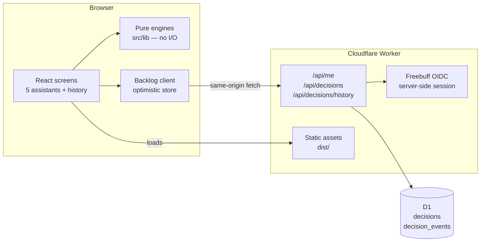

# Data Governance Agents

[](https://github.com/uchejerla/Data-Governance-Agents/actions/workflows/ci.yml)


Agent assistants that help data stewards deliver governance and stewardship work.

Five focused assistants, each a form → structured, defensible output. The reasoning is
deterministic over a governance snapshot — no model, no API key, no cost, same answer every
time — while the one piece that genuinely needs a server, the shared steward decision backlog,
runs on a Cloudflare Worker with D1 and Sign in with Freebuff. The [`agents/`](agents) folder
holds the prompt-level specification behind each assistant, so the logic can be pointed at a
real catalog, quality tool or policy library, or handed to an LLM later.

**Pre-1.0.** This is a working product demo, not a packaged release. See
[Limitations](#limitations) for what is deliberately not done yet.

## The assistants

| Assistant | Answers | Output |
| --- | --- | --- |
| **Catalog Curation** | Is this asset, glossary term or documentation actually governed? | Readiness score, gaps by severity, glossary collisions, a paste-ready curation note |
| **Data Quality Triage** | A rule failed — how bad is this, why, and who needs to know? | Severity, SLA and due date, ranked likely causes, owner, stakeholder update |
| **Policy & Control Q&A** | Can we do this, and which clause says so? | Coverage call, verbatim cited clauses, required controls, escalation route |
| **Access Review** | Should this request be approved? | Approve / conditions / escalate / deny, reasons per clause, expiry, reviewer note |
| **Stewardship Planner** | What should I do this month? | Now / Next / Later backlog with impact, effort, owner, dates and capacity check |

Catalog Curation covers glossary terms, asset metadata, documentation coverage and ownership in
one place — it replaced an earlier standalone glossary curator, because in practice those are
the same weekly job.

## Architecture



The split is deliberate: **the server owns identity and the record; the engines own the
reasoning.** Nothing about a catalog asset is sent to the server today — only the decisions a
steward records about it.

## Quickstart

Requires Node **≥ 22.22** (what the locked jsdom 30 needs) and npm.

```bash
npm ci                 # install exactly what the lockfile pins
npm run build          # static app into dist/
npm run dev:worker     # Worker + API + auth on http://localhost:8787 (serves dist/)
npm run dev            # UI on http://localhost:3000, proxying /api and /auth to the Worker
```

`npm run dev` gives the fastest loop. For the deployed shape — Worker serving the built app and
the API on one origin — run `npm run build && npm run dev:worker`.

Local auth configuration lives in `.dev.vars` (git-ignored); copy
[`.dev.vars.example`](.dev.vars.example) and fill in the development client id. No secret is
involved: `FREEBUFF_CLIENT_ID`, `FREEBUFF_ISSUER` and `APP_ORIGIN` are public configuration, the
platform injects the deployed values, and there is no client secret or session secret to manage.

## The shared decision backlog

Every recommendation — a curation gap, a glossary finding, a triaged rule, an access review, a
plan item — carries a stable key and one control surface:

- **Accept** records that the finding is agreed and being taken on.
- **Assign** accepts it and names the person who owns it.
- **Dismiss** records a considered no: the item drops out of the stewardship plan, its hours, and
  the exported Markdown, and moves to a *Dismissed* list where it can be restored.
- **Undo** withdraws the decision, if you were the steward who recorded it.

Decisions belong to the workspace, not the browser. Any signed-in steward sees the same backlog,
and each row carries who decided it and when. Signed out, every screen still works — the
assistants, the plan and the notes — but the controls show a sign-in prompt and nothing is
written.

**Server.** [`worker/index.ts`](worker/index.ts) wraps a fetch handler with
[`@freebuff/auth`](https://www.npmjs.com/package/@freebuff/auth) (OpenID Connect, PKCE,
server-side session cookie) and serves:

| Route | Behaviour |
| --- | --- |
| `GET /api/me` | The signed-in steward, or 401 |
| `GET /api/decisions` | The shared map, or 401 |
| `GET /api/decisions/history?limit=200&before=<id>` | The append-only event log, newest first, paged by event id, or 401 |
| `PUT /api/decisions/:key` | Accept / dismiss / assign; same-origin only, validated, then upserted |
| `DELETE /api/decisions/:key` | Withdraw your own decision (403 if someone else recorded it) |
| `GET /api/licence` | The installation's entitlement: status, modules, seats and limits, or evaluation mode. Public, and carries no customer identity |

Identity comes only from the verified session — no user id or email is ever accepted from the
request body. Mutations must pass `isSameOriginRequest`, and personalised responses are
`private, no-store`.

**Database.** D1 holds `decisions` (one row per recommendation: status, assignee, decided-by,
decided-at, updated-by, updated-at) and an append-only `decision_events` log, so overwriting a
decision never erases who decided what, when. The schema is created by the Worker on first use
(`CREATE TABLE IF NOT EXISTS`), because a Worker gets a binding, not a SQL console.

**Client.** [`src/lib/decisions.ts`](src/lib/decisions.ts) applies changes optimistically,
settles on the server's row, reverts and shows the server's reason if a write is refused,
refetches on window focus and every 30 seconds, and drops to read-only on a 401. That poll is
deliberate: a shared backlog does not need sub-second latency, and a realtime channel is a
separate decision.

**History.** *Decision history* (in the workspace nav) reads `decision_events` and groups it by
recommendation, so an item that was accepted, re-assigned and later withdrawn still shows every
step, the steward behind it and the timestamp — including decisions that no longer exist in the
backlog table. Keys are resolved back to the wording stewards see by
[`src/lib/history.ts`](src/lib/history.ts), which builds its index from the same engine helpers
the assistants and planner use. The view filters by steward and by activity, and is only
readable with a session because it carries identities. **Export CSV** pages through the whole
trail — not just the 200 changes the screen loaded — keeping the filters in view, and writes an
RFC 4180 table (item, detail, source, domain, activity, steward, assignee, UTC timestamp) ready
to attach to a governance review pack; cells that a spreadsheet would evaluate as a formula are
neutralised.

## Testing

```bash
npm test           # 81 tests, 9 files
npm run typecheck  # tsc -b --noEmit, covers app, config and Worker projects
npm run check      # typecheck, tests and the constraint floor — what CI runs
```

| Layer | What the tests prove |
| --- | --- |
| `src/lib/engines.test.ts` | Every decision branch of the five engines: scoring, gap severity, SLA derivation, clause retrieval, approve/deny rules, plan ordering and capacity |
| `src/lib/decisions.test.ts` | The API contract: signed-out reads, shared rows with attribution, optimistic writes, refused writes reverting with the server's reason, history paging and its backstop |
| `src/lib/history.test.ts`, `csv.test.ts` | Key → wording resolution, log grouping, CSV quoting and formula hardening |
| `src/components/decisions.dom.test.tsx` | The real components in jsdom: dismiss and accept, remount (a reload), plan and Markdown effects, history filtering, full-trail export |
| `src/components/render.test.tsx` | Every screen renders its expected content |
| `worker/licence.test.ts` | Verification against real ES256 tokens: tampering, the wrong key, a key id the install does not hold, invalid claims, expiry, not-yet-valid, seat counting and nested tiers |
| `worker/routes.test.ts` | Where the Worker applies it, with a stubbed session: a read-only install refuses writes before authentication, a foreign `Origin` is refused, a package without the audit trail gets a 403 on history, and the public entitlement carries no customer identity |
| `scripts/check-constraints.test.mjs` | The guard itself, against throwaway repositories: a suppression, a stub, a skipped or deleted test, a disabled CI gate and a loosened threshold are all blocked, prose is exempt, and an unrunnable guard exits 2 rather than passing |

CI ([`.github/workflows/ci.yml`](.github/workflows/ci.yml)) runs typecheck and tests on every
push to `main` from a clean `npm ci`.

## Security and data handling

- Identity is established by OIDC and read only from the session cookie; writes are
  same-origin-checked and validated server-side.
- The audit log records actor id, name and email; responses carrying it are `private, no-store`.
- No secrets are in the repository. `.dev.vars` is git-ignored and holds public configuration
  only; deployed values are injected by the platform.
- The seeded snapshot is fictional. In this demo, catalog data never leaves the browser.

See [SECURITY.md](SECURITY.md) for how to report a vulnerability and what is in scope.

## Deployment

```bash
npm run build && npm run build:worker   # dist/ and worker-build/index.js
```

Then deploy `deploy.json` (compatibility date `2026-10-19`, ES module worker, `dist/` assets) to
the platform environment. The deployed environment injects `FREEBUFF_CLIENT_ID`,
`FREEBUFF_ISSUER` and `APP_ORIGIN`; the D1 binding `DB` is attached per environment. Nothing
else is required, and no build step runs on the host.

Every environment gets its own database and its own registered callback
(`<origin>/auth/freebuff/callback`), so preview and production backlogs are separate. A
deployment receipt is not proof the app works: check the HTML and asset content types, a 401 on
the API when signed out, a 403 for a foreign `Origin`, then complete a real sign-in on the
deployed origin.

## Licensing

Self-hosted installs are licensed per customer with a signed offline token. [docs/licensing.md](docs/licensing.md)
has the packages, the token format and the issuing CLI (`npm run licence:issue`). The
configuration is public, not secret:

| Variable | Meaning |
| --- | --- |
| `LICENCE_KEY` | The signed token. Absent means evaluation mode. |
| `LICENCE_PUBLIC_KEY` | SPKI public key that verifies the token. |
| `LICENCE_KEY_ID` | Optional; pins the signing key. |
| `LICENCE_REQUIRED` | `true` makes a missing licence read-only instead of an evaluation. |

`GET /api/licence` returns the entitlement the shell filters screens with. The Worker,
not the browser, enforces expiry — writes are refused and reads and export keep working —
and the audit-trail module. Seats are modelled and returned but not enforced, because
there is no membership table yet.

## Project layout

```
agents/                 Markdown spec per assistant: role, inputs, rules, guardrails, prompt template
src/types.ts            Domain model: domains, assets, terms, rules, policy clauses, requests, people
src/data/seed.ts        Seeded snapshot of a mid-sized insurer's governance estate (dates relative to load)
worker/                 The only server: auth-wrapped fetch handler, decisions API, D1 schema
  index.ts
  licence.ts            Licence verification and entitlement evaluation (no bindings, portable)
wrangler.jsonc          Local Worker config: assets, D1 binding, worker-first routing
deploy.json             Sites deployment manifest (prebuilt Worker bundle + dist/)
.github/workflows/      CI: typecheck and tests on every push to main
src/lib/                The engines — pure functions, no React, no I/O
  decisions.ts          Client half of the backlog: keys, API calls, optimistic store, hook
  history.ts            Key-to-recommendation index and audit-log grouping for the history view
  csv.ts                CSV escaping, formula hardening and the browser download
  catalog.ts            Asset review, glossary issue detection, curation note composition
  quality.ts            Rule triage, cause ranking, severity and SLA derivation
  policy.ts             Clause retrieval, coverage assessment, grounded answer composition
  access.ts             Access decision rules and reviewer note
  planner.ts            Cross-source backlog harvest, prioritisation, capacity check
  licence.ts            Client half of licensing: one entitlement fetch, the store the shell reads
  util.ts               Dates, business days, pluralisation, formatting
scripts/issue-licence.mjs  Generates a signing key and signs a licence (docs/licensing.md)
src/components/         App shell, design system primitives, one screen per assistant
  Decision.tsx          Accept / dismiss / assign controls and status chips
  History.tsx           Decision history: the audit trail, grouped per recommendation
```

The separation matters: **every recommendation is produced by a testable function**, and the UI
only renders it. `planner.ts` imports the other four engines, so the monthly plan can never
disagree with what the individual assistants report.

The snapshot is a realistic fictional insurer — Customer & Growth, Claims & Fraud, Finance &
Risk and People domains, with tiered assets, a policy library, a live rule set, pending access
requests and outstanding attestations. All dates are generated relative to load time so the demo
never looks stale. Replace `src/data/seed.ts` with a real export and the assistant logic is
unchanged.

## Design principles

- **Grounded, never generic.** Answers quote clause IDs (`ACC-2.5`, `QLT-3.2`, `CLS-5.1`), not
  adjectives. Policy Q&A says "not covered" instead of inventing a rule.
- **The human decides.** The hub recommends a level, a severity or a priority. It never grants
  access, approves a request or reclassifies data.
- **Every output is paste-ready.** Reviewer notes, stakeholder updates and backlog markdown are
  written to be dropped into a ticket, an email or a wiki — one click to copy.
- **Dense, not decorative.** The layout favours numbers, chips and checklists over prose so a
  steward can scan it between meetings.

## Limitations

Honest list, because the demo is easy to mistake for a finished product:

- **The reasoning runs in the browser** over a snapshot bundled into the app. Nothing is served
  per customer yet, so a licence or tenancy check would be cosmetic until the snapshot moves
  behind an API.
- **The server stores decisions, not catalog data.** Assets, rules and policies never leave the
  browser in this build.
- **One workspace.** There is no tenant column; every signed-in steward shares one backlog.
- **Identity is Freebuff**, not an enterprise IdP. SSO is not wired.
- **Licensing is a commercial control, not DRM.** Expiry and the audit trail are enforced by
  the Worker; seats are modelled but not counted, and module gating for the browser-rendered
  assistants is a UI filter until the snapshot moves behind the API. [docs/licensing.md](docs/licensing.md)
  has the enforcement matrix and the honest limits.
- **No application-level rate limiting** beyond the platform's.
- **Advisory only.** It recommends; it never approves access, edits metadata or changes a rule.

## Roadmap

- **Self-hosted distribution**: Node + Postgres build, container image, migrations, health and
  version endpoints — the shape enterprise data-governance teams can run in their own cloud.
- **Seat and workspace enforcement**: both already travel in the licence token, but seats need a
  membership table to count against and workspaces need a tenant column.
- **SSO per install**: OIDC/SAML with group → role mapping, configured in admin settings.
- **Connectors**: Collibra / Purview / Alation for catalog, dbt or Great Expectations for quality,
  a policy store for clauses — served as a per-workspace snapshot.
- **Realtime decisions** so a teammate's change lands without the 30-second poll.
- **Optional LLM pass** to rewrite composed notes in house voice, while citations and decisions
  stay deterministic.

## Adding an assistant

1. Write `agents/<name>.md` — role, inputs, decision rules with clause references, output
   contract, guardrails, prompt template.
2. Add the engine in `src/lib/<name>.ts` as a pure function over the snapshot.
3. Add a screen in `src/components/assistants/`, register it in `src/App.tsx` and the nav in
   `src/components/Shell.tsx`.
4. Add tests in `src/lib/engines.test.ts` covering each decision branch.
5. Feed its findings into `planner.ts` so they appear in the monthly backlog.

See [CONTRIBUTING.md](CONTRIBUTING.md) for setup, conventions and review expectations.

## Licence

No licence is granted yet. The source is public for evaluation, but it is not open source:
reuse, redistribution and commercial use need written permission until a licence is published
here. If you are evaluating it and need terms, open an issue to start that conversation.
